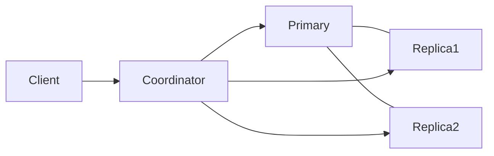
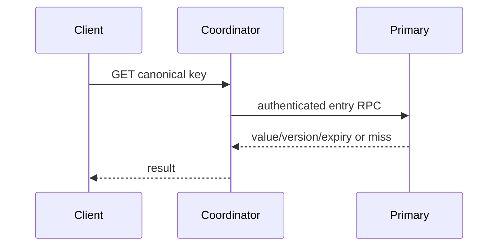
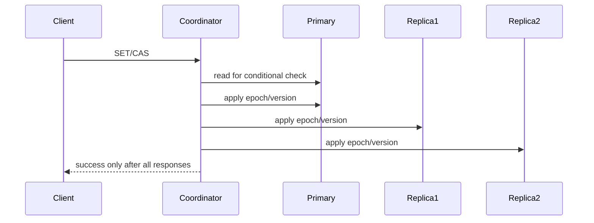
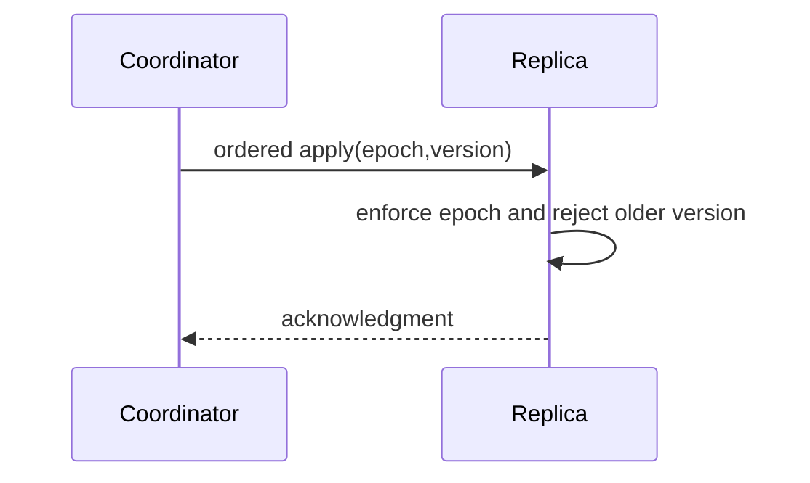
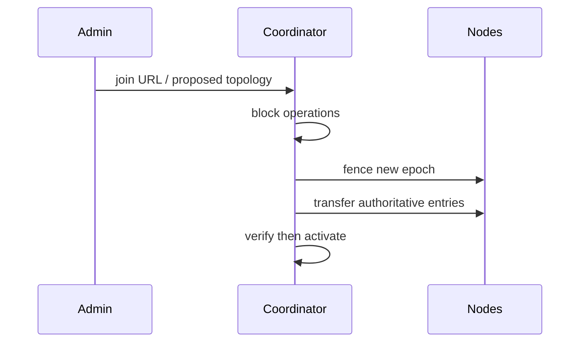
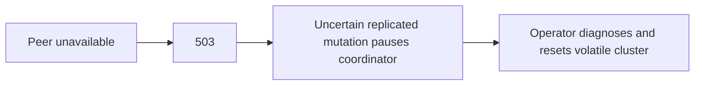
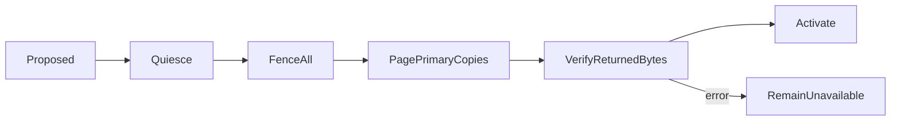

# Architecture and requirements

Functional acceptance for this baseline: route operations across processes; preserve ordered versions; atomic
conditional update at a single coordinator; bounded storage; TTL; replicated acknowledgment; reject stale storage
epochs; authenticated administration; transfer with mutation quiescence. Availability/durability targets are unverified.
Volatile cache data may disappear at any time through eviction, expiration, process loss, or reset.

Routing options: client-side routing saves a hop but distributes topology and retry logic to every client; proxy routing
concentrates connections/authority and adds a bottleneck; server forwarding permits any-node entry but adds forwarding
loops and topology coordination. This baseline chooses a proxy coordinator. Its global monitor orders every request and
topology change. The primary owner is the first distinct physical node clockwise; remaining clockwise distinct nodes are
replicas. No failure-domain awareness.

Replication is synchronous primary-replica, all configured owners required. Async replication would lower write latency
while increasing acknowledged-loss risk; quorum writes could increase availability but require recovery/conflict rules
absent here. Leaderless replication is deliberately excluded. The coordinator is a single manually administered
authority; running two is unsupported and unsafe. This is not a consensus control plane.

SHA-256 first big-endian signed 64 bits hashes UTF-8 encoded canonical key text. Virtual points hash
`nodeURL#decimalIndex`, sorted in signed long order, collisions sorted by URL. URLs are persistent node identifiers;
changing a URL changes placement. No modulo ring. Virtual-node configuration is part of topology and must agree across
nodes. With equal nodes expected movement on adding node n+1 is about 1/(n+1); skew depends on placement and workload.
128 points is a starting choice, not a universal optimum. Distribution assertions sample 30,000 uniform keys; Zipf
traffic can remain severely skewed even when key ownership is balanced.

Storage exact LRU/LFU scans on eviction and synchronizes all local access. This is simple and correct within its
contract, not optimized for million-request rates. FIFO uses insertion sequence. Lazy TTL checks and 250ms scans;
expiration compacts values into version tombstones. Metadata remains capacity bounded and can be evicted. A single
coordinator sends no concurrent replication writes and stops on ambiguous mutation, reducing delayed-operation hazards;
storage ordering watermarks alone do not survive eviction/restart.

Capacity example only: 1 million 1KiB values at roughly 1.3KiB logical weight and RF3 need roughly 3.9GB logical cluster
capacity plus large heap/network headroom. Logical weight estimates UTF-16 keys and 160 bytes entry overhead, not
measured heap allocation. HTTP buffers, snapshots, hash tables, runtime metadata and thread stacks require separate
heap/native headroom. Store low/high watermarks and admission policies are not implemented; admission evicts to the hard
logical limit. One monitor and O(entries) scans are expected bottlenecks. Scale-out does not remove coordinator
bottleneck.
